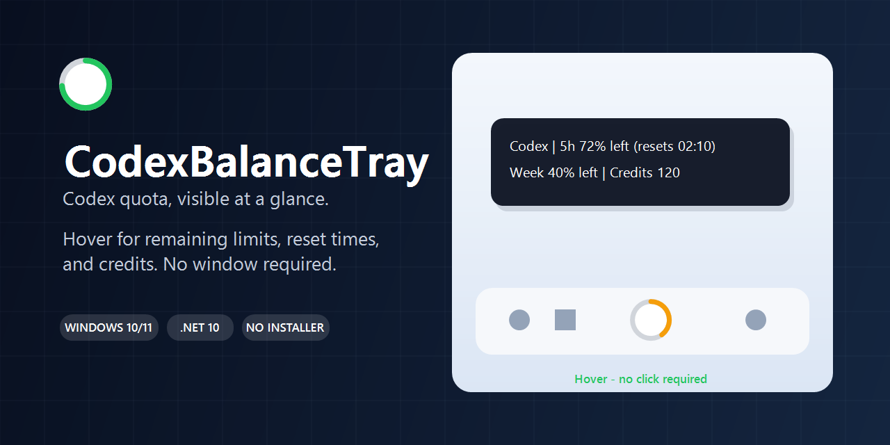
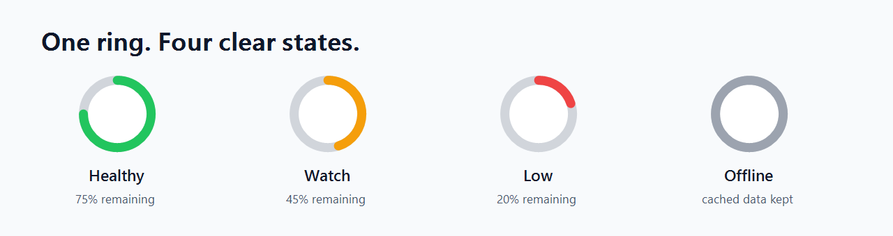

<div align="center">
  

  <p>
    <a href="https://github.com/khaichonggg/CodexBalanceTray/releases/latest"><strong>Download for Windows x64</strong></a>
    ·
    <a href="https://github.com/khaichonggg/CodexBalanceTray/issues">Report an issue</a>
  </p>

  <p>
    
    
    
  </p>
</div>

CodexBalanceTray is a lightweight Windows notification-area companion for
Codex. Hover its tray icon to see remaining quota, reset times, and credits
without opening a window.

> [!NOTE]
> This is an unofficial community project. It uses the official local
> `codex app-server` and requires the official Codex desktop app.

## Quick start

1. Download `CodexBalanceTray.exe` from the
   [latest release](https://github.com/khaichonggg/CodexBalanceTray/releases/latest).
2. Place it in a permanent folder and run it. No installer or separate .NET
   runtime is required.
3. Hover the tray icon to view usage. Right-click it for refresh, account, and
   startup options.

Windows may initially place the icon inside the `^` overflow area. You can pin
it from Windows taskbar settings if you want it always visible.

## At a glance



The colored arc represents the **lowest remaining percentage** across all
available quota windows:

| State | Remaining quota | Meaning |
| --- | ---: | --- |
| Green | Above 60% | Healthy |
| Orange | 31%–60% | Keep an eye on usage |
| Red | 30% or below | Low quota or a reached limit |
| Gray | No live data | Disconnected, offline, or cached |

The white center stays unchanged while the colored arc shortens with the
remaining quota. Offline mode keeps the last successful snapshot instead of
incorrectly showing zero.

## Features

- Hover-only quota display—no window or click required.
- Shows available quota windows, reset times, and credits.
- Refreshes every five minutes and reacts to app-server updates.
- Uses the lowest available quota window for the tray ring.
- Supports the current Codex account or an isolated ChatGPT login.
- Retries automatically after app-server failures.
- Starts with Windows for the current user, without administrator access.
- Runs as a single instance with no console or taskbar window.

## Account modes

**Current Codex account** uses the normal user-level `CODEX_HOME` through the
official Codex process.

**Independent ChatGPT account** uses a separate home at
`%LOCALAPPDATA%\CodexBalanceTray\codex-home` and the official browser OAuth
flow. It does not overwrite the account used by the Codex desktop app.

## Privacy

CodexBalanceTray does not copy, parse, or log Codex token files. Local storage
is limited to the selected account mode, startup preference, a last successful
quota snapshot, and seven days of status/error-category logs.

Logs exclude email addresses, tokens, OAuth URLs, account identifiers, and raw
app-server responses. The app does not open a network port or expose a public
API.

## Requirements

- Windows 10 or Windows 11 x64
- Official Codex desktop app installed

## Build from source

Install the .NET 10 SDK, then run:

```powershell
dotnet restore .\CodexBalanceTray.sln
dotnet test .\CodexBalanceTray.sln -c Release
dotnet publish .\src\CodexBalanceTray\CodexBalanceTray.csproj `
  -c Release -r win-x64 --self-contained true `
  -o .\artifacts\publish
```

The project publishes a self-contained, single-file
`CodexBalanceTray.exe`. Keep the executable at its final path so the per-user
Windows startup entry remains valid.

## Known limitations

- Windows controls whether a new tray icon starts in the visible area or under
  `^`; applications cannot force themselves to stay visible.
- The first release targets Windows x64 only.
- Code signing, automatic updates, and an installer are not included yet.

## Project usage

Copyright © 2026 Khaichong Ew. All rights reserved. No commercial-use permission is granted for the original project. Third-party components remain under their respective licenses.
